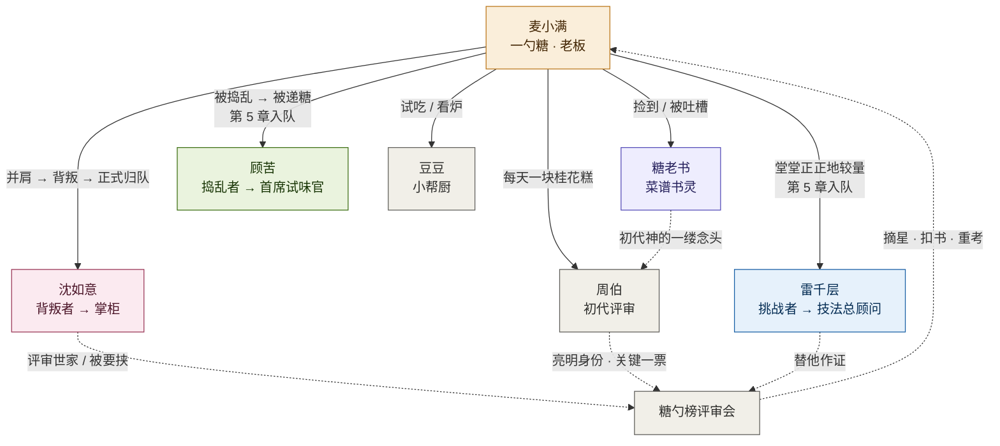
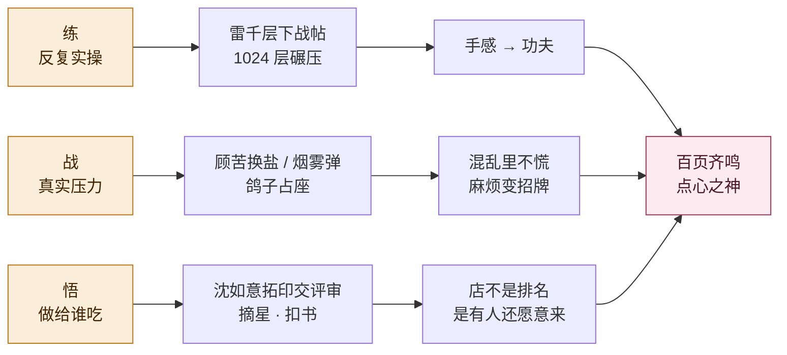

# 《欢闹厨房》主线故事大纲

> **文档类型**：游戏主线剧情企划案 · 完整大纲
> **版本**：v1.1 · 大团圆修订版（三类冲突角色全部谐星化，后期正式加入主角团队）
> **篇幅**：序章 + 5 个主线章节 + 终章，共 7 幕
> **基调**：轻松、欢快、热闹、暖心；**欢快大团圆**——挫折不沉重，反派全是谐星，没有真正的敌人，结局全员到齐
> **一句话梗概**：一个手笨但乐观的送货少年被一本会吐槽的旧菜谱砸中，为了把空白页一页页填满而开起甜品店，在被挑战、被捣乱、被背叛之后，终于学会了全部菜谱——以及第 101 页上那句谁也没写出来的答案。

---

## 目录

1. [创作基准（八维度定位）](#一创作基准八维度定位)
2. [世界观与核心规则](#二世界观与核心规则)
3. [角色设定](#三角色设定)
   - [3.7 反派谐星化与入队时间表](#37-反派谐星化与入队时间表)
4. [人物关系图](#四人物关系图)
5. [主线章节划分与关键剧情节点](#五主线章节划分与关键剧情节点)
6. [关键剧情节点总表](#六关键剧情节点总表)
7. [菜谱解锁与餐厅排名对照表](#七菜谱解锁与餐厅排名对照表)
8. [爽点节奏与情绪曲线](#八爽点节奏与情绪曲线)
9. [伏笔回收清单](#九伏笔回收清单)
10. [结局、彩蛋与可延展留白](#十结局彩蛋与可延展留白)
11. [附录：质量自检与后续扩写指引](#附录质量自检与后续扩写指引)

---

## 一、创作基准（八维度定位）

| 维度 | 设定 |
|---|---|
| **题材定位** | 休闲烹饪经营 + 轻喜剧成长。没有生死存亡，最大的危机是"今天这炉塌了"和"没人来吃了" |
| **世界观** | 一座把甜点当正经事的城市，「糖勺榜」决定一家店的生死。传说中有位「点心之神」，谁学全《一百零一页》，谁就是下一任 |
| **主角人设** | 麦小满，18 岁，面包房送货工。手笨、心软、乐观到有点没心没肺，但对"好吃"有野兽般的直觉 |
| **核心冲突** | 表层：把空白菜谱一页页填满；里层：从"为了当神"到"为了有人来吃"，再到"为了自己还想再做一炉" |
| **爽点设计** | 每章至少一个小打脸；每 2 章一个中打脸；第三章刻意收束做低谷；第五章三连收束 + 百页齐鸣为全篇最大爆点 |
| **节奏规划** | 起（序—一）→ 承（二）→ 转（三）→ 合（四—五）→ 余味（终章）。低谷只占一章，不拖泥带水 |
| **配角框架** | 毒舌引导者（糖老书）、堂堂正正的对手（雷千层）、搞笑捣乱者（顾苦）、温柔的背叛者（沈如意）、沉默的见证者（周伯）、童言试吃员（豆豆）；**三位冲突角色终局全部入队** |
| **开篇钩子** | 从天而降的旧书 + 连焦三炉 + 最后一页那句「留给还不知道自己为什么做点心的人」 |

**调性红线**

- 不出现死亡、血腥、真正的恶意；顾苦的"坏"是别扭，沈如意的"背叛"是委屈，雷千层的"狠"是较真。
- 每次失败都要有喜剧落点（面团糊脸、斗篷勾门把、鸽子占座），不许让观众替主角难过超过三十秒。
- 主角变强的过程必须**看得见**：焦痕、熟练度、显形的页数、队伍长度、门口那块越换越大的牌子。
- 反派不能蠢。雷千层强得让人服气，顾苦每次捣乱都真的造成了麻烦，沈如意那一刀必须真的疼。
- **但反派全是谐星**：每人配一套招牌翻车、一句招牌台词、一处反差萌；较真、捣乱、别扭都带笑点，不让玩家真的讨厌谁。
- **大团圆铁律**：三位冲突角色在第五章全部正式加入主角团队，终章全员到齐；不安排任何人离场、失踪或「暂时不归队」。
- 入队要当场、要热闹，伴着一句笑场台词完成；旧身份不洗掉，改成新用法（继续挑刺、继续捣乱、继续算账，只是方向调转）。

---

## 二、世界观与核心规则

### 2.1 《一百零一页》

一本封皮掉渣、会自己翻页、会打瞌睡、会打分的老菜谱，扉页写着：

> **「吃完这一本，你就是神。」**

书里住着个老头儿似的**书灵「糖老书」**：毒舌、爱挑刺、每次显形先扣分，口癖是「这炉……勉强能算个东西」。他其实是初代「点心之神」留下的一缕念头（**终章揭底**）。

### 2.2 菜谱的四条铁律（金手指的规则与限制）

| 规则 | 内容 | 游戏化落点 |
|---|---|---|
| **① 显形** | 所有页面原本空白。只有当店铺在「糖勺榜」升到对应段位，下一页才显出**整页菜谱**——菜名、料单、分量、火候、步骤全给 + 一句莫名其妙的提示。**菜谱给全，但手不会替你会**：照着抄，手生照样糊（由 ② 承接） | 排名解锁关卡 / 新菜谱 |
| **② 三重磨炼** | 显形 ≠ 学会。每道菜必须过三关：**练**（反复实操，攒手感）、**悟**（弄明白这道点心是做给谁的）、**战**（在真实压力下完整做出来：限时客人、挑战赛、捣乱突发） | 熟练度 / 剧情关 / 挑战关 三类玩法 |
| **③ 不可作弊** | 抄别人的方子、请人代做、用捷径道具，页面会褪回空白并长出霉斑，得从头再练 | 反作弊提示 + 搞笑惩罚动画 |
| **④ 越往后越挑人** | 第 100 页的要求是：把前面所有**失败过**的菜，一炉一炉重做一遍 | 终局前的"回想关卡" |

**成功反馈**：一页真正学会，纸上才长出糖霜插图，还带一股刚出炉的香味。这是全作最重要的正反馈仪式。

**第 101 页**：无题、无提示，**永不因排名显形**。

### 2.3 糖勺榜（餐厅排名体系）

| 段位 | 覆盖范围 | 对应章节 | 评定口味 |
|---|---|---|---|
| 铜勺 | 街角 | 第一章 | 有客人愿意进门就行 |
| 银勺 | 街区 | 第二章 | 技法开始被挑剔 |
| 金勺 | 全城 | 第三章 | 只看配方出处与标准度 |
| 琉璃勺 | 全国 | 第四章 | 规则第一次为"心意"松口 |
| 云顶勺 | 云端食榜 | 第五章 | 终极评定，全城围观 |

> 评审会不是反派，是**制度性压力**：一板一眼、只认技法不认心意。终局因主角被撬开一条缝，评定条例里多了一行「谁在吃」。

### 2.4 核心结构：三类冲突 × 三重磨炼

这是整条主线的骨架——**每个冲突角色专门负责把主角的一重磨炼逼出来**，所以三类冲突不是并列摆设，而是成长机制的化身。

| 冲突类型 | 角色 | 逼出的磨炼 | 主角因此学会 |
|---|---|---|---|
| 正面交锋的挑战者 | 雷千层 | **练** | 把"手感"练成"功夫"，再敢把功夫放下 |
| 恶意捣乱者 | 顾苦 | **战** | 在混乱里不慌，还能顺手把麻烦变成招牌 |
| 背叛者 | 沈如意 | **悟** | 点心不是一个人的手艺，店也不是排名 |

> **v1.1 补充**：三位冲突角色在第五章全部加入主角团队，「逼主角成长」顺势转为「陪主角经营」；旧性格不改，只换方向。详见 3.7 入队时间表。

---

## 三、角色设定

### 3.1 主角 · 麦小满

| 项 | 内容 |
|---|---|
| 身份 | 18 岁，原本给面包房送货；后为「一勺糖」甜品店老板 |
| 性格 | 乐天、手笨、韧性极强、心软到有点傻；对"好吃"有近乎野兽的直觉 |
| 口头禅 | 「再来一炉就好！」 |
| 动机曲线 | ①「书上说能当神，那试试呗」→ ②「有人还愿意来吃」→ ③「我自己还想再做一炉」 |
| 致命弱点 | 不会拒绝人，把别人的需要永远排在自己前面——**这正是沈如意那一刀的根** |
| 成长阶梯 | 手笨 → 手感 → 功夫 → 心意 → 无配方 |
| 名场面 | 序章连焦三炉后，蹲在炉边听声音，第四炉成了；终章故意烤焦一角，只给自己吃 |

---

### 3.2 引导者 · 糖老书（书灵）

- **形象**：泛黄书页里浮出的一张皱巴巴的老脸，戴一副用糖丝绕的眼镜，说两句就打瞌睡。
- **性格**：毒舌、嘴硬心软、护短；主角被外人欺负时它比谁都凶。
- **口癖**：「这炉……勉强能算个东西。」（全书最后一句也是这句）
- **职能**：讲解规则、发任务、扣分、制造笑点、埋最大伏笔。
- **真相**：初代「点心之神」留下的一缕念头。他当年也没写出第 101 页，等的不是"最厉害的人"，是"肯为自己在炉前多站一会儿的人"。
- **关键动作**：第三章被评审会扣走前，偷偷把第 101 页的一角撕下来塞进主角围裙（第四章才被发现）。

---

### 3.3 正面交锋的挑战者 · 雷千层 ★（谐星化 · 第 5 章入队）

| 项 | 内容 |
|---|---|
| 身份 | 千层酥世家「雷记」第七代传人，22 岁，公认的天才；入队后任「一勺糖」**技法总顾问** |
| 性格 | 冷面、毒舌、强迫症（称量到 0.1 克、计时到 0.1 秒）、胜负欲极强，但**绝对公平**：从不使阴招，输了当场认，还会替对手把掉地的托盘捡起来 |
| **谐星标签：冷面反差萌** | 随身带一杆小秤，连客人的笑声都要「记个数值」；嘴上天天说「我只是路过」，却风雨无阻每天准点来挑刺、准点吃完两块；家里偷偷收藏了主角每一炉失败的作品，按焦度编号归档，被豆豆翻出来时当场耳根通红 |
| **招牌翻车** | 第一次端着 1024 层来踢馆，被顾苦的鸽子撞翻托盘，他坚持把 1024 层一片片捡回去重新数，数到天黑；每次发表「我不信神」宣言，必被糖老书一句「那你天天来干嘛」噎住 |
| 表层动机 | 「技术即真理，神位该给最准的人」——他不信一本破书能造出神 |
| 深层动机 | 雷记被「点心之神」的传说压了三代，祖父临终还在念「差一炉」。他要亲手终结这个神话，让家族的名字不再活在一个传说的影子下面 |
| 与主角的三次交锋 | 第二章初战**碾压**（主角擀到第五层就破，他 1024 层分毫不差）→ 第二章再战**平局**（技法输，"好吃"那一票周伯投了主角）→ 第五章终战**主动认输**，交出雷记秘传并当场入队 |
| **入队后** | 负责技法研发与新人培训，把「雷记」改成「一勺糖·雷记分店」；依旧每天准点挑刺，只是挑完会顺手把碗洗了 |
| 名台词 | 「我不信神。我只信秤。」／「你这层数根本不标准……为什么好吃。」／「……这一炉，我认。」／「我只是路过。（第 412 天）」 |
| 设计要点 | **必须强到让人服气**，笑点全部来自反差而非削弱实力。他的存在逼主角把"手感"练成真功夫；他从不使坏，所以第四章替主角作证才格外有分量 |

---

### 3.4 恶意捣乱者 · 顾苦（自称「苦味博士」）★（谐星化 · 第 5 章入队）

| 项 | 内容 |
|---|---|
| 身份 | 30 多岁，黑斗篷是拿家里窗帘改的（下摆还留着流苏），登场必先发表宣言；入队后自封「一勺糖**首席试味官兼防捣乱演练总指挥**」 |
| 性格 | 戏剧化、浮夸、对自己人讲义气、笨拙到总把自己坑了；被拆穿后会小声补一句「……下次不会了」，然后下次照样 |
| **谐星标签：正经地不正经** | 随身一本《作战记录簿》，把每次捣乱编号成「苦味作战第 07 号：糖罐置换行动」，工工整整写计划、画示意图、盖自制印章，然后每次都翻车；宣言念到一半总被鸽子 / 门铃 / 豆豆的童言打断 |
| **招牌翻车** | 踩自己撒的糖粉滑倒、被自己雇的鸽子啄、斗篷勾住门把、被自己的烟雾弹熏哭、伪装评论家时忘了摘掉写着「苦味博士」的袖章；有回把盐换进糖罐，结果自己先偷吃了一勺，苦着脸灌了三杯水 |
| 动机 | 小时候攥着零钱站在甜品店门口，因为差两文钱被赶走。从此认定「甜是哄人的，苦才是真的」。他想让全城人尝一口"真实的味道"——**其实只是想让当年那个小孩，被谁递一块什么** |
| 捣乱手法（对应关卡机制） | 糖罐偷换盐、烤箱温度计调乱、胡椒粉烟雾弹、雇鸽子占满露天座、伪装美食评论家打一星、把门牌改成「苦瓜料理」 |
| 弧光 | 捣乱 → **第三章低谷时破天荒没捣乱**，放下一袋没动过手脚的糖就跑（跑两步滑倒、爬起来继续跑）→ 第四章被主角顺手救了一次 → 第五章被「苦甜交织」化解，**当场入队** |
| **入队后** | 那群捣乱用的鸽子被正式收编成「**咕咕外送队**」，成了游戏里的外送玩法；他负责新菜试吃、专挑最难吃的边角料，还把自己的六种捣乱手法编成「防捣乱演练」给新人上课，讲得极其骄傲 |
| 名台词 | 「甜是骗局！我要让这座城清醒！」（说完滑倒）／「……当年要是有人给我这个就好了。」／「这不是投降，是……深入内部观察。」 |
| 设计要点 | 他的捣乱要**真的造成麻烦**（否则"战"这关不成立），但落点永远是笑，不是恨。他是全作的喜剧发动机，也是唯一在低谷章递出暖意的人 |

---

### 3.5 背叛者 · 沈如意 ★（谐星化 · 第 5 章入队）

| 项 | 内容 |
|---|---|
| 身份 | 20 岁，开张第一天上门应聘的搭档；管账、跑堂、最会哄客人，是「一勺糖」的另一半；归队后正式复职「**掌柜**」 |
| 性格 | 温柔利落、笑起来像店里的灯、算账从不出错、心里有本没人看过的账；别扭起来会一本正经地做很笨的事 |
| **谐星标签：最拙劣的伪装** | 出走后其实没走远，在街对面摆了个「代记账」小摊，戴大口罩 + 墨镜 + 遮阳帽，自以为天衣无缝——全街坊都认得她，周伯每天还特地去照顾一次生意；豆豆隔三差五跑去报告「如意姐姐今天又把算盘拿反了」 |
| **三层动机（大团圆调性减重）** | ① **表层**：评审世家的女儿，家族拿她弟弟的**甜点学徒名额**做筹码，要她交出菜谱拓印（弟弟其实自己跑来「一勺糖」偷吃，被豆豆当场抓包——和豆豆当年入职一模一样，镜像笑点） ② **里层**：她也曾是菜谱候选继承者被刷掉，想证明「没有那本书，我也能被看见」 ③ **最里层**：她真的喜欢这家店，也真的委屈——主角每次说「再来一炉就好」，从来没问过她累不累 |
| 背叛行为（轻量化但不消失） | 金勺评定前夜，紧张得手抖，拓印三页交评审会，还按了三个糖霜指印、把「海盐焦糖」拓成了「海盐焦…」；评审会老先生们对着指印研究半天，借题发挥判「配方来源不明」→ 摘星、封炉、暂扣菜谱 → 她连夜消失，账本上只留一行「对不住」 |
| 名台词 | 「你每次都说'再来一炉就好'……可你从来没问过我累不累。」（说完，顾苦在旁边举手「我累」，全场笑场，气就化开了） |
| 弧光 | 背叛 → 街对面摆摊 → 第四章暗中补回被扣的原料单（**不露面**）→ 第五章回来「我只替你站完最后一炉」→ **被豆豆一句「你抽屉还留着呢」当场留下，正式归队** |
| **入队后** | 复任掌柜，账本重新摊回柜台；终章当着全员在最后一页写下「今天不累。」；和顾苦组成「挑刺二人组」，一个挑味道一个挑账目，天天斗嘴 |
| 设计要点 | 动机可被理解，行为不被原谅，但**别扭要可爱、伤害要轻**：不安排痛哭跪求，不写苦情身世，不让人真的恨她。她仍是全篇唯一的情绪断崖，只是断崖底下垫了软垫——**大团圆铁律：她必须归队，且归队当章就留在店里** |

---

### 3.6 配角框架

| 角色 | 设定 | 剧情职能 |
|---|---|---|
| **周伯** | 每天来买最便宜的一块桂花糕、从不说话的老邮差 | 真实身份是退休的**初代糖勺评审**，因当年一次误判退隐。第四章被主角"没有配方的桂花糕"（正是亡妻的味道）弄到当场落泪，亮明身份；第五章投下关键一票。全作沉默的见证者 |
| **豆豆** | 街坊小孩，一开始来偷吃被抓包，顺势成了试吃员 | 童言暴击担当、喜剧调剂；**第五章用一句「你抽屉还留着呢」把沈如意留下**，是全员团圆的关键推手 |
| **糖勺榜评审会** | 一群抱着条例本、戴白手套的老先生 | 非反派，制度性压力。只认技法不认心意；终局改写条例，加一行「谁在吃」 |
| **雷记老掌柜** | 只存在于雷千层的回忆里，临终一句「差一炉」 | 挑战者动机的情感锚点 |

### 3.7 反派谐星化与入队时间表

> 本作**没有真正的敌人**。三位冲突角色都是「还没坐到同一张桌子上」的队友，第五章全部正式加入主角团队，终章全员到齐。

| 角色 | 谐星定位 | 招牌翻车 | 反差萌 | 入队节点 | 入队后身份 | 对应玩法 |
|---|---|---|---|---|---|---|
| **雷千层** | 冷面反差萌 | 1024 层被鸽子撞翻，坚持一片片捡回重数到天黑 | 天天说「我只是路过」，却偷偷收藏主角每一炉失败品并按焦度编号 | 第五章 5-2 认输交秘传时当场入队 | 技法总顾问；「一勺糖·雷记分店」店长 | 技法研发 / 精准度挑战 / 可操作角色 |
| **顾苦** | 正经地不正经 | 换盐后自己先偷吃一勺，苦着脸灌三杯水 | 《作战记录簿》编号盖章，宣言总被打断 | 第五章 5-3 被「苦甜交织」化解后当场入队 | 自封首席试味官兼防捣乱演练总指挥 | 咕咕外送队 / 干扰事件演练 / 试吃加成 |
| **沈如意** | 最拙劣的伪装 | 街对面戴口罩墨镜摆摊，全街坊都认得她 | 算盘拿反、被周伯天天照顾生意 | 第五章 5-4 站完最后一炉，被豆豆一句留下，正式归队 | 复任掌柜；与顾苦组成「挑刺二人组」 | 经营结算 / 店铺加成 / 可操作角色 |

**入队写法三条约定**

1. **入队要当场、要热闹**：不搞单独的和解长镜头，一律在众人面前、伴着一句笑场台词完成，仪式感靠「多摆一副碗筷」体现。
2. **旧身份不洗掉，改成新用法**：雷千层继续挑刺（改成帮着挑）、顾苦继续捣乱（改成防捣乱演练）、沈如意继续算账（改成算全店的账）。性格弧光是转方向，不是换人。
3. **终章必须全员同框**：主角、糖老书、雷千层、顾苦、沈如意、周伯、豆豆，一个不少；不留「某某会不会回来」的悬置。

---

## 四、人物关系图

### 三类冲突的推动路径

---

## 五、主线章节划分与关键剧情节点

> 每章结构：**本章概要 → 情绪曲线 → 解锁内容 → 关键剧情节点（编号）→ 本章爽点 → 章末钩子**

---

### 序章 · 《从天而降的一百零一页》

> **概要**：送货路上被一本旧书砸中。扉页写着「吃完这一本，你就是神」。第一页显形「焦糖布丁」：菜谱、分量、火候都写着，他照着做，连糊三炉。
> **情绪曲线**：好奇 ↑ → 连焦三炉 ↓↓ → 一点小火苗 ↑↑
> **解锁内容**：基础烘烤 / 火候判定；菜谱第 1 页

| # | 关键剧情节点 |
|---|---|
| 0-1 | 麦小满蹬着送货三轮车拐过巷口，一本掉渣的旧书从天而降，正砸在怀里 |
| 0-2 | 书自己翻到扉页，糖老书第一次开口：「先说好，我不教笨蛋。」 |
| 0-3 | 第 1 页显形：「焦糖布丁 · 提示：别看钟。」主角没看懂，连焦三炉，厨房冒黑烟 |
| 0-4 | 蹲在炉边生闷气，忽然听见糖在锅里"噗"了一声——**顿悟：火候要听声音，不是看钟** |
| 0-5 | 第四炉成功。纸上慢慢长出糖霜插图，还飘出一股刚出炉的香味 |
| 0-6 | 书末一行小字：「要有 人 吃。」主角挠头："那……得开个店吧？" |

- **本章爽点**：第一页显形的仪式感；把"看钟"的常规思路打脸。
- **章末钩子**：翻到最后一页，只有一行字——「**第 101 页 · 留给还不知道自己为什么做点心的人**」。

---

### 第一章 · 铜勺篇《一勺糖，一间店》

> **概要**：漏雨的旧仓库改成小店，伙伴们陆续到齐，第一次捣乱反而捣出了招牌。
> **情绪曲线**：手忙脚乱 → 热闹 ↑ → 被认可 ↑↑
> **解锁内容**：接单系统 / 店铺装扮 / 糖艺入门；菜谱第 2–8 页；**铜勺**

| # | 关键剧情节点 |
|---|---|
| 1-1 | 租下巷口漏雨的旧仓库，刷了三遍漆还是能看见水痕，挂牌「一勺糖」 |
| 1-2 | 豆豆翻窗偷吃被抓包，主角没骂人，塞给他一块："尝尝，说得出哪里不对就算你工钱。" → 试吃员入职 |
| 1-3 | 沈如意上门应聘，一个下午把乱成一团的账本理平，还顺手哄好了等急了的客人 |
| 1-4 | **顾苦首次登场**：把糖罐换成盐，发表宣言「甜是骗局！」→ 主角将错就错，做出「海盐焦糖」，当天爆单；顾苦踩到自己撒的糖粉滑倒，斗篷勾住门把 |
| 1-5 | 雷千层路过，隔着窗看了一眼主角歪歪扭扭的酥皮，丢下一句「这也叫千层？」就走 |
| 1-6 | 周伯第一次进门，只买最便宜的一块桂花糕，坐靠窗，一句话不说 |
| 1-7 | 铜勺评定通过。周伯吃完，说了全章唯一一句台词：「……再来一块。」 |

- **本章爽点**：① 被捣乱反做出招牌（小打脸）；② 全城最沉默的客人开口要第二块（暖点）。
- **章末钩子**：菜谱一次显出三页。糖老书打了个哈欠：「别高兴，这才刚够你摔的。」

---

### 第二章 · 银勺篇《擀不薄的千层》

> **概要**：被天才按在地上摩擦，然后靠"等"这个谁也没教的道理扳回半局。
> **情绪曲线**：被碾压 ↓↓ → 笨拙爬升 ↑ → 平局小爆 ↑↑
> **解锁内容**：擀制 / 层次控制 / 限时订单；菜谱第 9–20 页；**银勺**

| # | 关键剧情节点 |
|---|---|
| 2-1 | 雷千层正式下战帖：千层对决，三日后，当街开炉 |
| 2-2 | **初战惨败**：主角擀到第五层就破皮，面团糊了一脸；雷千层 1024 层，分毫不差，全程没抬过一次眼 |
| 2-3 | 闭关练擀面喜剧蒙太奇：面团堆成小山，豆豆在里面迷了路；糖老书在旁边计数「第 87 次，还是个饼」 |
| 2-4 | 顾苦放「胡椒烟雾弹」搅局，全店打喷嚏，他自己先被熏哭 |
| 2-5 | 一片混乱里主角忘了计时，面团在一旁静静松弛——**顿悟：层次不是叠出来的，是等出来的** |
| 2-6 | 再战：技法分仍输，但"好吃"那一票，周伯投了主角 → **平局**。雷千层第一次皱眉：「你这层数根本不标准……为什么好吃。」 |
| 2-7 | 银勺到手，队伍排到街口 |

- **本章爽点**：平局打脸（中打脸）；周伯那一票；雷千层的皱眉比任何奖杯都爽。
- **章末钩子**：打烊后，沈如意把一张纸叠了又叠，塞进围裙口袋，灯灭了才走。**（伏笔：拓印）**

---

### 第三章 · 金勺篇《最甜的那天下了雨》【转折 · 低谷章】

> **概要**：生意最火的那天，一切被抽走。全篇唯一的情绪断崖，但落点仍是暖的。
> **情绪曲线**：全篇最高点 ↑↑↑ → 断崖 ↓↓↓ → 触底 → 一粒火星 ↑
> **解锁内容**：裱花 / 多桌并行；菜谱第 21–40 页（随后被扣）；**金勺评定作废**

| # | 关键剧情节点 |
|---|---|
| 3-1 | 排队排到街口，招牌换新，全员备战金勺评定；沈如意把账本算到最后一文 |
| 3-2 | 评定前夜，评审会突然到场，出示**三页菜谱拓印**：「配方来源不明」 |
| 3-3 | 摘星、封炉、菜谱暂扣。主角回头找人——沈如意不见了，账本上只留一行「对不住」 |
| 3-4 | 全城改口："那家店原来是靠抄的。" 雷千层站在街对面没说话，转身走了 |
| 3-5 | 主角第一次不想开炉，把模具摔在地上。**这是全作唯一一次他没说"再来一炉就好"** |
| 3-6 | **顾苦破天荒没捣乱**：放下一袋没动过手脚的糖，一句话没说就跑，跑两步又滑倒，爬起来继续跑 |
| 3-7 | 豆豆和周伯蹲在地上，把碎模具一块块粘起来。周伯第一次主动开口：「明天……还开吗。」 |
| 3-8 | 主角重新点炉，只做了一炉**谁也不卖**的布丁，四个人分着吃完 |
| 3-9 | 糖老书被扣走前，偷偷把第 101 页的一角撕下来，塞进主角围裙（第四章才发现） |

- **本章爽点**（刻意压到最小）：不安排打脸，只给"还有人愿意来"的小暖点——顾苦那袋糖、粘起来的模具。张弛需要一章呼吸。
- **章末钩子**：围裙口袋里那张纸角，上面什么字都没有。

---

### 第四章 · 琉璃勺篇《没有菜谱的三十天》

> **概要**：书被扣走，反倒逼出真本事。三重打脸集中爆发的一章。
> **情绪曲线**：稳步爬升 ↑↑ → 爆发 ↑↑↑
> **解锁内容**：**无配方模式**（凭手感选料）/ 复原关卡；已学菜式全部重铸；**琉璃勺**

| # | 关键剧情节点 |
|---|---|
| 4-1 | 评审会给最后一次机会：三十天后重考，**但不许用那本菜谱** |
| 4-2 | 主角靠记忆和手感，把已学的每一道重做一遍。焦掉的、塌掉的、破皮的，一炉一炉来 |
| 4-3 | 顾苦捣乱升级，却次次自坑；有一回斗篷真被烤箱勾住，主角顺手把人拽出来，两人愣了三秒，谁也没说话 |
| 4-4 | 被扣的原料单莫名被人补齐，字迹工工整整——沈如意**在暗处，没露面** |
| 4-5 | **雷千层上门，不是挑战**：「我来替你作证。那些页数，是他自己一炉一炉练出来的。」 |
| 4-6 | 重考当天，主角端出一炉**没有配方的桂花糕**——凭周伯每天买的那块，猜了三十天 |
| 4-7 | 周伯尝一口，当场落泪：那是他亡妻的味道。他亮明**初代糖勺评审**身份，评定条例被撬开一条缝 |
| 4-8 | 琉璃勺到手，菜谱归还 |

- **本章爽点**（三连打脸）：① 打脸评审会「离了书你什么都不是」；② 打脸全城议论；③ 打脸主角自己「我以为我离不开那本书」。外加雷千层作证的高光。
- **章末钩子**：归还的菜谱，100 页里已显形 87 页；最后 13 页写着同一句提示：「**把摔过的，再做一遍**」。

---

### 第五章 · 云顶勺篇《百页齐鸣》【全篇最大高潮】

> **概要**：云端食榜·全国甜点大会。三类冲突同一天收束，然后是一整个通宵的"回想"。
> **情绪曲线**：三线并进 ↑↑ → 三连收束 ↑↑↑ → 百页齐鸣 ↑↑↑↑
> **解锁内容**：全菜式合流 / 极高压多线订单；菜谱第 88–100 页；**云顶勺 → 点心之神**

| # | 关键剧情节点 |
|---|---|
| 5-1 | 大会开场，全城围观。顾苦把全场的糖换成苦精，雷千层摆出 1024 层，评审会抱紧条例本 |
| 5-2 | **雷千线收束 · 入队**：终战，1024 层 vs 主角"不数层"的一炉。雷千层尝完沉默很久：「……这一炉，我认。」当场交出雷记秘传，然后板着脸补一句「明天我来上班，别迟到」——**第一位队友入队**。糖老书：「你不是不信神吗。」「……我只是路过。」 |
| 5-3 | **顾苦线收束 · 入队**：主角没把糖换回来，直接改做「苦甜交织」——焦糖的苦、可可的苦、回甘的甜。顾苦吃了一口，斗篷底下掉眼泪：「……当年要是有人给我这个就好了。」抹完脸立刻宣布「这不是投降，是深入内部观察」，并把鸽子全数捐出成立「咕咕外送队」——**第二位队友入队** |
| 5-4 | **沈如意线收束 · 入队**：她回来，不解释、不求原谅，「我只替你站完最后一炉」；那句「你从来没问过我累不累」说出口时，顾苦在旁边举手「我累」，全场笑场，气就化开了。散场前她想走，豆豆一句「如意姐姐，你抽屉还留着呢，算盘我也没借给别人」把她留了下来——**第三位队友入队，账本重新摊回柜台** |
| 5-5 | **第 100 页的要求**：把前面所有失败过的菜重做一遍。**新入队的三人各守一炉**——雷千层数层、顾苦试味、沈如意记账，主角通宵把焦掉的、塌掉的、破皮的，一炉一炉重来 |
| 5-6 | 天亮时百页齐鸣，100 页全部长出糖霜插图，整条街都是香味 |
| 5-7 | 云端食榜授「**点心之神**」。全城欢呼，匾额抬到门口；主角把三位新队友一起推到台前：「这炉不是一个人烤的。」 |

- **本章爽点**：三连收束 + **三人全部入队** + 百页齐鸣，全篇最大爆点。三个曾经让他难受的人，各用最符合自己性格的方式认了他，然后坐到了同一张桌子上。
- **章末钩子**：主角翻到**第 101 页——仍是空白**。

---

### 终章 · 《第101页：给自己的一炉》

> **概要**：所有人在等他接神位，他第二天照常开了店门——然后全店一起开了第二炉。
> **情绪曲线**：热闹余韵 → 忽然安静 → **全员同框的大团圆 ↑↑**

| # | 关键剧情节点 |
|---|---|
| 6-1 | 众人等着接匾、开连锁、上电视。主角第二天照常卷起门帘，匾额没接，挂在了门后 |
| 6-2 | **全员到齐**：雷千层系着围裙在数层、顾苦指挥鸽子排队外送（鸽子不听指挥）、沈如意把账本摊回柜台、周伯坐靠窗老位置、豆豆踮脚看炉、糖老书趴在柜台上打瞌睡。一个不少 |
| 6-3 | 他给自己烤了一炉**谁也不卖、故意焦了一角**的布丁——和序章第一炉一模一样，只是这次是故意的；结果被六个人分着吃光了，顾苦还举手要第二块 |
| 6-4 | 糖老书揭底：初代神当年也没写出第 101 页。他等的不是最厉害的人，是「肯不为排名、不为客人，只为自己在炉前多站一会儿的人」 |
| 6-5 | 第 101 页终于显字：「**因为你还想再做一炉**」 |
| 6-6 | 书合上，变成一本普通的旧菜谱——**但没走**。第二天它又自己翻回柜台上，嘟囔「神位我不要，这炉我得看着」，从此当起了店里的菜单本，继续挑刺 |
| 6-7 | 沈如意当着全员在账本最后一页写下「今天不累。」；顾苦凑过来补一行「今天也不苦。」；雷千层在旁边默默记了个数值，被全员起哄 |
| 6-8 | **结局确认**：主角历经被挑战、被捣乱、被背叛、被摘星、被扣书的全部磨难，学会了《一百零一页》的全部菜谱，成为「点心之神」；三位曾经的对手全部成为队友，全店大团圆，神位匾被拿去垫了歪掉的面粉缸 |

- **本章爽点**：不是打脸，是「放下」+「全都在」的爽。全城争的东西他随手搁下，全城争不到的那张桌子，他坐满了。
- **收束**：主线闭环于序章那炉焦布丁，落到「为什么做点心」这个从第一页就埋下的问题；**所有角色都在场，无一人离场、无一条关系悬置**。

---

## 六、关键剧情节点总表

| 幕 | 核心事件 | 冲突登场 | 菜谱进度 | 排名 | 情绪值 |
|---|---|---|---|---|---|
| 序章 | 捡到书、连焦三炉、开店决定 | 糖老书 | 1 / 101 | — | 3 → 6 |
| 第一章 | 开张、伙伴到齐、换盐反爆单 | 顾苦、雷千层（露面） | 8 / 101 | 铜勺 | 6 → 7 |
| 第二章 | 千层惨败 → 平局 | 雷千层（正战） | 20 / 101 | 银勺 | 2 → 8 |
| 第三章 | **背叛、摘星、封炉、扣书** | 沈如意（爆发） | 40 → 被扣 | 作废 | 9 → **1** → 3 |
| 第四章 | 无配方三十天、周伯亮身份 | 三条线回流 | 87 / 101 | 琉璃勺 | 3 → 9 |
| 第五章 | 三连收束、**三人全部入队**、百页齐鸣、封神 | 三线同日收束并入队 | **100 / 101** | 云顶勺 | 9 → **10** |
| 终章 | 第 101 页显字、**全员同框大团圆** | — | **101 / 101** | 不重要了 | 8（余味） |

---

## 七、菜谱解锁与餐厅排名对照表

| 段位 | 章节 | 显形页数 | 代表菜式 | 对应新玩法 | 主导磨炼 | 主要压力源 |
|---|---|---|---|---|---|---|
| 入门 | 序章 | 第 1 页 | 焦糖布丁 | 火候判定（听声） | 练 | 自己 |
| 铜勺 | 第一章 | 第 2–8 页 | 海盐焦糖、桂花糕、奶香小方 | 接单 / 店铺装扮 | 战 | 顾苦换盐 |
| 银勺 | 第二章 | 第 9–20 页 | 千层酥、可颂、蝴蝶酥 | 擀制 / 层次 / 限时单 | 练 | 雷千层 |
| 金勺 | 第三章 | 第 21–40 页 | 裱花蛋糕、慕斯、糖霜饼干 | 裱花 / 多桌并行 | 悟 | 沈如意 |
| （扣书期） | 第四章 | 全部重铸 | 无配方桂花糕 | 凭手感选料 / 复原关 | 练（终极） | 评审会 |
| 琉璃勺 | 第四章末 | 第 41–87 页 | 糖艺、发酵、冷冻甜点 | 糖艺 / 温控 | 悟 | 制度 |
| 云顶勺 | 第五章 | 第 88–100 页 | 苦甜交织、全菜式合流 | 极高压多线订单 | 战（终极） | 三线同场 |
| 神位 | 终章 | **第 101 页** | 焦了一角的布丁 | 无（自由炉） | 无 | 无 |

> **设计说明**：第 101 页是唯一不绑定排名、不绑定玩法、不产出任何数值的一页——它只负责回答"为什么还在开炉"。

---

## 八、爽点节奏与情绪曲线

| 幕 | 小爽点（每幕必有） | 中 / 大爽点 | 打脸对象 | 情绪落点 |
|---|---|---|---|---|
| 序章 | 第四炉成功、第 1 页显形 | — | "看钟"的常规思路 | 好奇 |
| 第一章 | 换盐反成招牌 | 周伯开口「再来一块」 | 顾苦 | 热闹 |
| 第二章 | 面团山蒙太奇 | **平局打脸**、周伯关键一票 | 雷千层（半次） | 不服输 |
| 第三章 | 顾苦那袋糖、粘好的模具 | 刻意不给大爽点 | 无（呼吸章） | 被惦记 |
| 第四章 | 顺手救了顾苦 | **三连打脸** + 雷千层作证 | 评审会 / 全城 / 自己 | 扬眉 |
| 第五章 | 雷千层「这一炉，我认」 | **三连收束 + 三人入队 + 百页齐鸣** | 所有质疑 | 全篇顶点 |
| 终章 | 故意焦了一角、顾苦举手要第二块 | **全员同框大团圆** | 无（放下） | 温热余味 |

**节奏底线自检**

- 每 1–2 章有小打脸：✔（第一、二、四、五章）
- 每 3–5 章有中打脸：✔（第二章平局、第四章三连）
- 大高潮落在第五章：✔
- 低谷只占一章且不给压迫感超过半章：✔（第三章 3-6 就开始回暖）
- 连续两章以上无爽点：✘ 不存在
- 主角能力/地位/见识每章可感知递进：✔（手笨 → 手感 → 功夫 → 心意 → 无配方 → 放下）
- 反派谐星化且全员入队、终章无一人离场：✔（见 3.7 入队时间表与第五章 5-2/5-3/5-4）

---

## 九、伏笔回收清单

| 伏笔 | 埋设 | 回收 | 效果 |
|---|---|---|---|
| 第 101 页那句「留给还不知道自己为什么做点心的人」 | 序章 0-6 | 终章 6-4 | 全作主命题闭环 |
| 连焦三炉 / 焦布丁 | 序章 0-3 | 终章 6-2（故意焦一角） | 从失败变成选择 |
| 周伯每天买最便宜的桂花糕、从不说话 | 第一章 1-7 | 第四章 4-6 / 4-7 | 亡妻的味道 + 初代评审身份 |
| 沈如意打烊后叠了又叠的纸 | 第二章 2-7 钩子 | 第三章 3-2（拓印） | 背叛不突兀 |
| 糖老书撕下的纸角 | 第三章 3-9 | 第四章（发现）→ 终章（书灵真相） | 引导者一直在偷偷帮忙 |
| 顾苦「差两文钱」的童年 | 角色设定 / 第一章宣言 | 第五章 5-3「当年要是有人给我这个就好了」 | 捣乱者被温柔接住 |
| 雷记老掌柜临终「差一炉」 | 角色设定 | 第五章 5-2 雷千层认输、交秘传 | 三代人的执念被放下 |
| 评审会只认技法 | 第二章起 | 第四章松口 / 第五章条例加「谁在吃」 | 制度被"心意"改写 |
| 漏雨的屋顶 | 第一章 1-1 | 终章仍在漏，主角懒得修，成了招牌 | 轻喜剧余味 |
| 账本上的「对不住」 | 第三章 3-3 | 终章 6-7 当着全员写下「今天不累。」 | 从裂痕变成团圆的一页 |
| 顾苦的鸽子与《作战记录簿》 | 第一章起捣乱 | 第五章收编为「咕咕外送队」、入队后当演练教材 | 捣乱道具变成团队资产 |
| 雷千层的「我只是路过」 | 第一章 1-5 | 第五章入队、终章第 412 天还在说 | 冷面人设的长线笑点 |

---

## 十、结局、彩蛋与可延展留白

**结局确认**：麦小满历经正面挑战（雷千层）、恶意捣乱（顾苦）、亲密背叛（沈如意）、摘星封炉、菜谱被扣、无配方重考以及百页回想，掌握了《一百零一页》的**全部**菜谱，被云端食榜承认为「**点心之神**」。三位曾经的对手在第五章全部成为队友，终章全员同框——**欢快大团圆，无一人离场**。终章揭示：神位从来不是学完菜谱的奖品，而是「学完之后还愿不愿意再做一炉」，以及「这一炉有没有人一起吃」。

**终章彩蛋（片尾画面 · 全员同框）**

- 豆豆踩着凳子挂上新牌：「**今日营业 · 排名不重要**」。
- 「一勺糖·雷记分店」开在隔壁，其实是同一张桌子的延长；雷千层每天准点来挑刺，挑完顺手把碗洗了，第 412 天还在说「我只是路过」。
- 顾苦的「咕咕外送队」正式挂牌营业，鸽子依旧不太听话；他自封首席试味官，专挑烤过头的边角料，还开了「防捣乱演练」小课堂，讲得极其骄傲。
- 沈如意复任掌柜，账本摊在柜台上，当着全员写下「**今天不累。**」；顾苦在旁边补一行「今天也不苦。」
- 糖老书没走，趴在柜台上当菜单本，继续给每一炉挑刺：「这炉……勉强能算个东西。」
- 周伯坐靠窗老位置，还是最便宜的一块桂花糕，只是现在有人陪着吃。
- 门后那块「点心之神」的匾，被拿来垫了歪掉的面粉缸。

**可延展留白（DLC / 后日谈，不含「角色会不会回来」类悬置）**

1. 合上又翻开的旧菜谱，会不会哪天再砸中下一个人？（可引出续作新主角，不影响本作团圆）
2. 周伯当年那次"误判"判的是谁？与雷记「差一炉」是否同源？
3. 顾苦的两文钱、豆豆第一次独立看炉、雷千层的失败品收藏册，可各自做成支线小章节。
4. 「咕咕外送队」与三人入队后的店铺经营，可拓展为后日谈关卡组。

---

## 附录：质量自检与后续扩写指引

**八维度自检**

| 检查项 | 结果 |
|---|---|
| 逆袭起点够低吗 | ✔ 送货工、手笨、连焦三炉、漏雨铺子 |
| 金手指有清晰规则与限制吗 | ✔ 显形 / 三重磨炼 / 不可作弊 / 越后越挑人，四条铁律 |
| 前 3 章有打脸设计吗 | ✔ 换盐反爆单、平局、周伯关键一票 |
| 力量（等级）层级清晰吗 | ✔ 铜 → 银 → 金 → 琉璃 → 云顶，五阶对应五章 |
| 「众人轻视 → 被打脸」结构完整吗 | ✔ 全城「靠抄的」→ 第四章无配方重考 → 第五章百页齐鸣 |
| 反派够聪明吗 | ✔ 雷千层强到服气、顾苦每次都真造成麻烦、沈如意那一刀真疼 |
| 伏笔全部回收吗 | ✔ 见第九节 10 条 |
| 调性符合休闲烹饪游戏吗 | ✔ 无死亡、无真正恶意、低谷不超一章、失败必带喜剧落点 |
| 反派够谐星吗 | ✔ 三人各有谐星定位、招牌翻车、反差萌（见 3.7） |
| 后续全部加入主角团队吗 | ✔ 第五章 5-2 / 5-3 / 5-4 逐人入队，终章 6-2 全员同框 |
| 是欢快大团圆吗 | ✔ 无一人离场、无一条关系悬置；书灵也留了下来 |

**与玩法配置的接口建议**

- 每章的「解锁内容」可直接映射为关卡组 / 新机制开放节点。
- 「三重磨炼」建议做成每道菜的**三段式关卡**：练习关（可无限重试，不计分）→ 剧情关（悟，触发短对话）→ 挑战关（战，限时 / 突发干扰）。
- 顾苦的六种捣乱手法本身就是现成的**干扰事件池**，可按段位逐级投放。
- 第三章建议做成一次"失去全部加成"的特殊关卡组，让玩家和主角一起体验"没有菜谱"，第四章再逐道返还，正反馈最强。
- **入队即解锁**：5-2 / 5-3 / 5-4 三人入队时，分别解锁对应可操作角色或店铺岗位（技法研发 / 咕咕外送 / 经营结算），让玩家当场感受到「队伍变大了」，与剧情爽点同步。

**后续扩写**：本大纲可直接拆为逐章剧本 / 对话脚本 / 关卡剧情文案；`.learnings/` 下已建立角色、地点、情节点与世界观记忆文件，续写前请先读取，避免设定串味。
